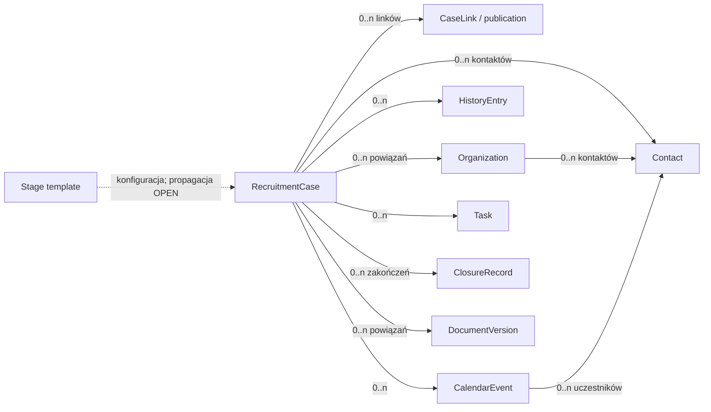

# Słownik i koncepcyjny model domenowy

**Stan:** `BASELINED`. Zapisane tu fakty są `APPROVED`, o ile wyraźnie nie podano `OPEN`. **To nie jest schemat bazy danych.**

## Pojęcia

| Pojęcie | Znaczenie / odróżnienie |
|---|---|
| **Konto użytkownika** (*UserAccount*) | Kontekst wejścia do prywatnego workspace'u po zalogowaniu; rejestracja, odzyskiwanie, zarządzanie profilem i sesją są `PROPOSED/OPEN`, a nie opisanym tu mechanizmem Auth. |
| **Prywatna przestrzeń danych** | Osobiste sprawy, kontakty, wydarzenia, notatki i dokumenty; niedostępne dla nieuprawnionych osób (`BR-030`, `NFR-001`). Fizyczna reprezentacja i zakres relacji własności: `OPEN-013/OPEN-032`. |
| **Sprawa rekrutacyjna** (*RecruitmentCase*) | Niezależny, trwały kontekst potencjalnej pracy, aplikacji lub kontaktu; może mieć wiele okresów aktywności i zakończeń. Nie musi mieć ogłoszenia ani konkretnego stanowiska. |
| **Organizacja** (*Organization*) | Firma/pracodawca, agencja lub inny podmiot; jedna organizacja może uczestniczyć w wielu sprawach. Jej rola w danej sprawie ma znaczenie. |
| **Pracodawca** | Organizacja, dla której docelowo wykonuje się pracę; bywa nieujawniona, np. kontakt od agencji. |
| **Osoba kontaktowa** (*Contact*) | Rekruter/CEO/CTO/inny rozmówca; istnieje również poza sprawami, może uczestniczyć w wielu sprawach. |
| **Ogłoszenie/publikacja** (*JobPosting/Publication*) | Źródło szczegółów oferty; ta sama sprawa może mieć wiele URL-i/publikacji; brak wymogu ogłoszenia. |
| **URL źródłowy** (*CaseLink*) | Uporządkowany link i jego rola (główna publikacja, dodatkowa, formularz, profil, korespondencja itd.). Sam link nie stanowi treści korespondencji. |
| **Źródło znalezienia** | Gdzie dostrzeżono ofertę; odrębne od kanału, którym wysłano aplikację. |
| **Kanał aplikacji/kontaktu** | Jak faktycznie wykonano kontakt/aplikowanie, jeżeli miało miejsce. |
| **Status ogólny** (*CaseStatus*) | Jedna z czterech wartości: `Zapisane`, `Kontakt rozpoczęty`, `W rekrutacji`, `Zakończone`. |
| **Etap** (*RecruitmentStage*) | Bardziej szczegółowe stadium rekrutacji; szablony globalne i układ dla konkretnej sprawy. Niezależny od statusu. |
| **Zakończenie** (*ClosureRecord*) | Fakt zakończenia sprawy z obowiązkowym wynikiem; zachowywany także po wznowieniu. |
| **Akcja biznesowa** | Jawna czynność użytkownika dotycząca życia sprawy, np. „Oznacz jako aplikowane”; nie jest ręczną korektą błędu. |
| **Wpis historii** (*HistoryEntry*) | Istotne udokumentowane zdarzenie biznesowe lub notatka, z datą zdarzenia i datą dodania do CRM, jeśli je rozróżnia. Nie jest logiem technicznym. |
| **Wydarzenie kalendarza** (*CalendarEvent*) | Planowana lub dodana po fakcie rozmowa/spotkanie z własnym cyklem życia, także z wieloma uczestnikami. Przełożenie zmienia termin z zachowaniem historii dat, nie jest osobnym zatwierdzonym statusem (`OPEN-021`). Nie każdy wpis historii jest wydarzeniem kalendarza. |
| **Zadanie** (*Task*) | Działanie do wykonania, ogólne lub związane ze sprawą; sugestia systemowa nie jest automatycznie zadaniem. |
| **Sugestia** (*Suggestion*) | Rekomendacja z reguł, a nie autonomiczne działanie. |
| **Dokument/wersja** (*Document/DocumentVersion*) | Plik dostępny globalnie w bibliotece lub tylko dla sprawy; wersja CV może zostać wskazana jako faktycznie wysłana. |
| **Import / wsad** (*ImportBatch*) | Przetworzenie CSV/XLSX z mapowaniem, podglądem, decyzjami dla wierszy i raportem. Model przechowywania: `OPEN-010/OPEN-035`. |

### Trzy różne pojęcia „zdarzenia”

- **Akcja biznesowa** — polecenie użytkownika, np. rejestracja zaproszenia lub zamknięcie.
- **Wpis historii** — projekcja istotnych faktów na osi czasu; datę faktu odróżnia się od daty wprowadzenia.
- **Wydarzenie kalendarza** — obiekt planowany/rozliczany (odbyte, nieodbyte itd.), który może generować istotny wpis w historii, ale nie zastępuje jej.

Konkretne persystowanie tych danych to decyzja techniczna — nie zakładamy event sourcingu, mikrousług ani danego modelu relacyjnego.

**Uwaga:** ogłoszenie/oferta i jego adres URL również nie są synonimami. Odnośnik może wskazywać jedną z wielu publikacji; finalną granularność trwałych bytów ogłoszenia i publikacji określi `OPEN-002/OPEN-025`. Nie łącz ich z bytem `RecruitmentCase` tylko dlatego, że są prezentowane razem w widoku.

## Koncepcyjne relacje

Diagram jest **koncepcyjny**: krotności `0..n` ilustrują optionalność w wielu scenariuszach, nie definiują kardynalności DB ani obligatoryjnych pól. Kontakt może istnieć bez sprawy; wpis rzeczywistej komunikacji musi dotyczyć sprawy (`BR-018`). Relacje osoby, organizacji i sprawy nie powinny sugerować, że pracodawca zawsze jest znany.

## Przykłady poprawnych modeli

- Ogłoszenie zapisane, bez aplikacji: sprawa `Zapisane`, link do oferty, **bez** zdarzenia wysłania CV.
- CTO przez LinkedIn bez CV: sprawa i kontakt, rejestracja kontaktu, status `Kontakt rozpoczęty`.
- Agencja z ukrytym klientem: znana agencja i kontakt, pole pracodawcy pozostaje nieznane.
- Dwa procesy w jednej firmie: dwie sprawy, jeden profil organizacji, możliwie ten sam kontakt.
- Trzy publikacje tej samej oferty: jedna sprawa z trzema uporządkowanymi linkami, chyba że użytkownik świadomie rozstrzygnie inaczej.

## Luki modelu

Ostateczne pola, wymagalność, referencje, identyfikacja duplikatów, wersje, retencja i usuwanie: `OPEN-002/OPEN-005/OPEN-006/OPEN-024/OPEN-036`. Nie generuj z tego diagramu migracji bazodanowej bez dalszej decyzji.
