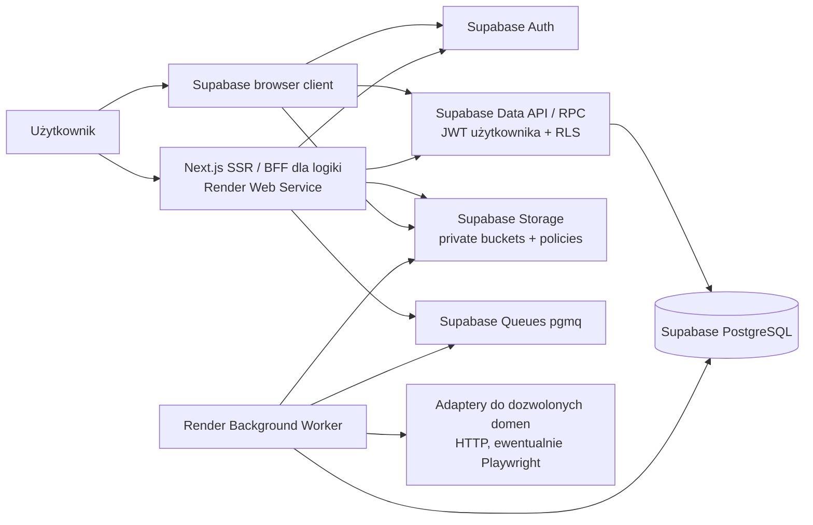

# Architektura logiczna Jobs CRM

**Status:** BASELINED — decyzje TD 1.31–1.38 oraz [ADR-0012](../decisions/adr/0012-supabase-native-auth-sessions-rls.md) APPROVED/ACCEPTED w swoim zakresie. Rebaseline Supabase-native z 2026-10-29; szczegóły interfejsów PROPOSED. Dokumentacja nie autoryzuje Auth/RPC ani deploymentu.

## System / kontenery (C4-lite)

## Moduły domenowe (jeden repozytorium / modular monolith)

- Identity & Account; Recruitment Cases/Lifecycle; Organizations/Contacts; History/Events; Tasks/Suggestions; Documents; Quick Capture/Smart Import; CSV/XLSX Import; Global Search; Operations.
- **Proponowana** struktura: `src/app` (Next UI/routes/actions), `src/modules/<module>/{domain,application,infrastructure}`, `src/shared` (kontrakty infrastruktury), `src/worker` (consumer). Moduły komunikują się poprzez jawne interfejsy usług; bez krzyżowych importów z warstw infrastruktury.
- Server Components korzystają z serwerowego klienta/usług; Server Actions i Route Handlers obsługują operacje wymagające serwera, logiki biznesowej lub granicy zaufania. Nie tworzymy warstwy HTTP, która wyłącznie przekazuje wszystkie żądania do Supabase. Każde wejście serwerowe: zaufana tożsamość, autoryzacja, walidacja i kontrola właściciela; browser nie nadaje sobie uprawnień.
- Standardowe dane prywatne: browser albo server client → Supabase Data API z JWT użytkownika → RLS. Server client jest per-request; bez współdzielonej mutowalnej tożsamości i prywatnego cache A/B. Drizzle do schematów/migracji i kontrolowanych operacji wewnętrznych; nie omija RLS dla zwykłego CRUD. RLS obejmuje tabele i powiązania; atomowe komendy wielu zapisów wymagają zweryfikowanego pojedynczego RPC.
- Worker jest procesem wdrożeniowym oddzielnym od web, ale należy do tego samego systemu; kolejki nie wolno wystawiać zwykłym użytkownikom. Bez sekretów w payloadach i logach.

## Macierz wyboru adaptera

Poniższe przypisania konkretnych przypadków są **PROPOSED** do weryfikacji w slice. Zatwierdzony jest minimalny podział odpowiedzialności z ADR-0012, bez obowiązku proxy całego Data API.

| Potrzeba | Preferowany adapter | Warunek / granica |
|---|---|---|
| Standardowy login/signup/logout/refresh i operacje interaktywne SDK | Browser Supabase client | Wspierany model sesji, PKCE/redirects i bezpieczne cookies; bez service-role/sekretów. |
| SSR i odczyt danych użytkownika na serwerze | Server Supabase client | Per-request, zaufana weryfikacja tożsamości, JWT użytkownika/RLS, brak cache leakage. |
| Prosty user-scoped CRUD bez dodatkowej logiki | Browser lub server client → Data API | RLS/grants/walidacja muszą egzekwować cały kontrakt; wybór adaptera nie rozszerza uprawnień. |
| Komenda domenowa, sekrety, wrażliwa operacja | Server Action / Route Handler + server client | Własna autoryzacja/walidacja, właściwa reauth zgodnie z OPEN; BFF tylko jeśli wnosi granicę zaufania/logikę. |
| OAuth callback lub wymagany kontrakt HTTP | Route Handler + server client | PKCE exchange, bezpieczny redirect i aktualizacja cookies zgodne z SDK. |
| Kilka zapisów wymagających jednego atomic commit | Minimalna funkcja PostgreSQL przez `supabase.rpc()` | INVOKER/grants/RLS i rollback; nie sekwencja niezależnych insertów HTTP. |
| Migracje zatwierdzonego schematu | Drizzle, poza user request path | Wersjonowane migracje, testy i osobna autoryzacja; OPEN-002 nadal blokuje model sprawy. |

## Kluczowe przepływy

1. **Logowanie:** e-mail/hasło lub Google OAuth/PKCE → Supabase Auth → standardowe browser/server clients i cookies zarządzane przez SDK → zweryfikowany kontekst → Data API/RLS. Reset e-mailem i self-signup używają mechanizmów dostawcy. Bez HttpOnly-only/brokera; access JWT może działać do expiry po logout. Szczegóły: [security-and-privacy.md](security-and-privacy.md).
2. **Zmiana sprawy:** UI → action → walidacja/autoryzacja → domenowa komenda → zapis stanu + fakt biznesowy/audyt zgodnie z regułami → odczyt. Nie utożsamiać wpisu historii z logiem technicznym.
3. **Smart Import:** kontrola domeny przed DNS/HTTP i ponownie przy każdym redirect; HTTP-first → ewentualnie worker/headless dla domeny zatwierdzonej do takiego przetwarzania → podgląd → świadomy zapis.
4. **CSV/XLSX:** plik → parsowanie w pamięci → mapping/preview → zatwierdzony zestaw → jedna operacja DB → raport i identyfikator idempotencji.
5. **Dokument:** autoryzacja → private Storage → metadane wersji w SQL; osobno powiązanie z case i fakt wysłania.
6. **Search:** indeksy PostgreSQL (FTS/GIN), odczyt w kontekście konta przez RLS, wynik prowadzi do źródłowego rekordu. Brak indeksowania treści CV.

## Dane, granice i jakość

Szczegółowy model w [data-and-persistence.md](data-and-persistence.md). NFR/FR/AC mają pierwszeństwo przed przykładowymi nazwami tabel. Brak rozstrzygniętych enumów wyników zamknięcia, rozmiarów plików i okresów sesji; nie ustawiaj ich po cichu. Obsługa mobile/desktop według UX Blueprint, docelowa dostępność OPEN-017/033.

## Rozwój

Możliwy późniejszy staging, publiczne API REST, osobne usługi dla obciążających zadań, indeks semantyczny i Career Agent — żadne z nich nie należy do MVP bez decyzji. Konfiguracje dev/prod oddzielone od początku; sekrety nigdy w repo.
