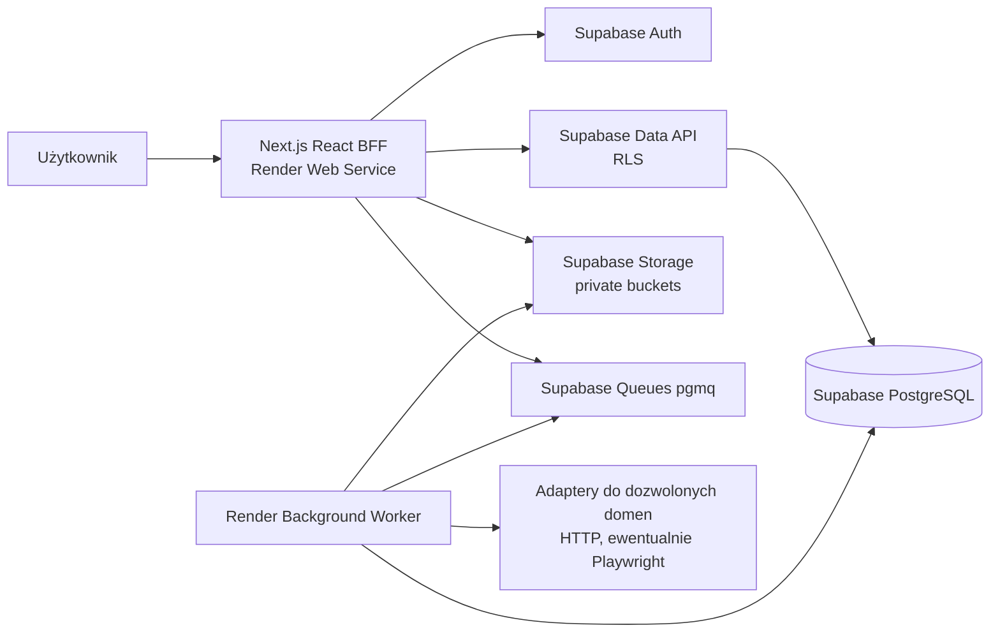

# Architektura logiczna Jobs CRM

**Status:** BASELINED — decyzje 1.31–1.38 APPROVED; szczegóły interfejsów PROPOSED. Bez kodu i bez deploymentu.

## System / kontenery (C4-lite)

## Moduły domenowe (jeden repozytorium / modular monolith)

- Identity & Account; Recruitment Cases/Lifecycle; Organizations/Contacts; History/Events; Tasks/Suggestions; Documents; Quick Capture/Smart Import; CSV/XLSX Import; Global Search; Operations.
- **Proponowana** struktura: `src/app` (Next UI/routes/actions), `src/modules/<module>/{domain,application,infrastructure}`, `src/shared` (kontrakty infrastruktury), `src/worker` (consumer). Moduły komunikują się poprzez jawne interfejsy usług; bez krzyżowych importów z warstw infrastruktury.
- Server Components czytają dane przez serwerowe usługi, Server Actions obsługują interakcje, Route Handlers HTTP, statusy zadań i upload. Każdy punkt wejścia: uwierzytelnienie, autoryzacja, walidacja i kontrola właściciela. Klient nie jest źródłem tożsamości.
- Standardowa ścieżka danych prywatnych to BFF → Supabase Data API z kontekstem użytkownika → RLS. Drizzle do schematów/migracji i kontrolowanych operacji backendu. RLS obejmuje tabele i powiązania; wieloetapowe komendy wymagają zweryfikowanej transakcji RPC.
- Worker jest procesem wdrożeniowym oddzielnym od web, ale należy do tego samego systemu; kolejki nie wolno wystawiać zwykłym użytkownikom. Bez sekretów w payloadach i logach.

## Kluczowe przepływy

1. **Logowanie:** e-mail/hasło lub Google OAuth → Supabase Auth → serwerowy BFF → chroniona sesja → bieżący użytkownik → dane przez RLS. Dokładne wdrożenie HttpOnly oraz revocation: [security-and-privacy.md](security-and-privacy.md).
2. **Zmiana sprawy:** UI → action → walidacja/autoryzacja → domenowa komenda → zapis stanu + fakt biznesowy/audyt zgodnie z regułami → odczyt. Nie utożsamiać wpisu historii z logiem technicznym.
3. **Smart Import:** kontrola domeny przed DNS/HTTP i ponownie przy każdym redirect; HTTP-first → ewentualnie worker/headless dla domeny zatwierdzonej do takiego przetwarzania → podgląd → świadomy zapis.
4. **CSV/XLSX:** plik → parsowanie w pamięci → mapping/preview → zatwierdzony zestaw → jedna operacja DB → raport i identyfikator idempotencji.
5. **Dokument:** autoryzacja → private Storage → metadane wersji w SQL; osobno powiązanie z case i fakt wysłania.
6. **Search:** indeksy PostgreSQL (FTS/GIN), odczyt w kontekście konta przez RLS, wynik prowadzi do źródłowego rekordu. Brak indeksowania treści CV.

## Dane, granice i jakość

Szczegółowy model w [data-and-persistence.md](data-and-persistence.md). NFR/FR/AC mają pierwszeństwo przed przykładowymi nazwami tabel. Brak rozstrzygniętych enumów wyników zamknięcia, rozmiarów plików i okresów sesji; nie ustawiaj ich po cichu. Obsługa mobile/desktop według UX Blueprint, docelowa dostępność OPEN-017/033.

## Rozwój

Możliwy późniejszy staging, publiczne API REST, osobne usługi dla obciążających zadań, indeks semantyczny i Career Agent — żadne z nich nie należy do MVP bez decyzji. Konfiguracje dev/prod oddzielone od początku; sekrety nigdy w repo.
